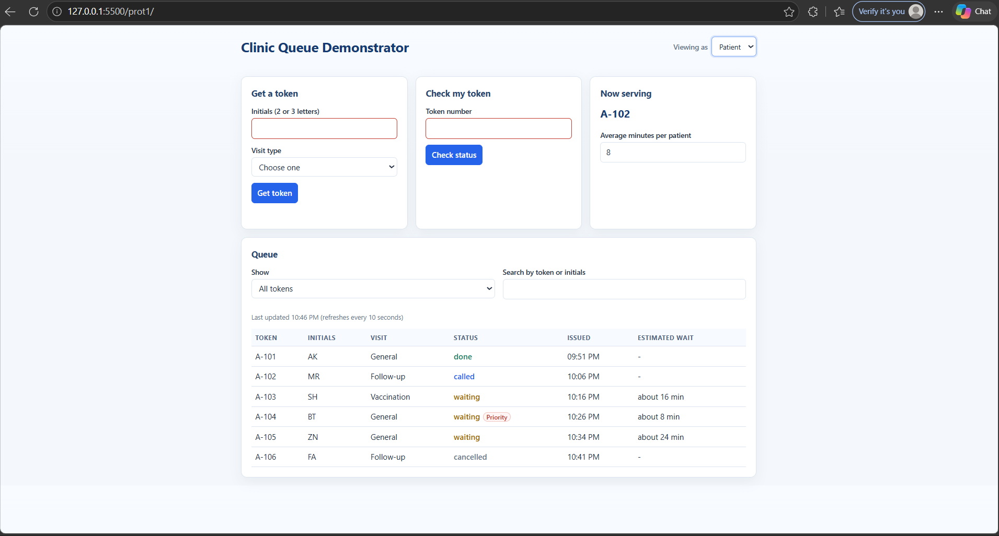

# Clinic Queue Demonstrator

Assignment 1: Client-side web application.

**Assigned idea:** Clinic Queue Demonstrator. Token issuance, queue status, staff priority controls and wait-time estimates, with a clear demo-only notice.

**Extra rule / data variant from instructor:** _(write it here, and say how the app handles it)_

> Demo only. This is a classroom prototype, not a real clinic system. All records are made up and only use initials.

## What it does

- A patient gets a token by entering initials and a visit type.
- A patient can check a token number to see their position and estimated wait.
- Staff can call the next patient, mark priority, mark done, or cancel a token.
- Wait estimate = position in line x average minutes per patient (editable).
- The queue can be filtered by status and searched by token or initials.
- The "Viewing as" selector switches between Patient and Staff views.

## Setup

No install or build step.

1. Download or clone this repository.
2. Open `index.html` in any modern browser (double-click works).

```


## Files

| File | Purpose |
| --- | --- |
| `index.html` | Semantic page structure and forms |
| `style.css` | Layout (Grid and Flexbox), responsive rules, plain styling |
| `script.js` | State, validation, filtering, estimates, simulated polling |
| `DESIGN.md` | Wireframe and design note |

## Screenshots
Patient Window:

Staff Window:


## AI assistance disclosure

 An AI assistant (Claude) was used for assistance in the assignemnt. His work was reviewed and tested and then integrated

## Reused code and assets

None. No libraries, frameworks, templates or external assets are used.